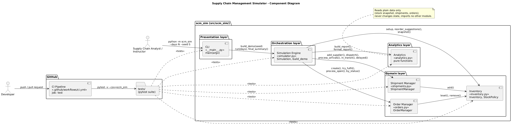
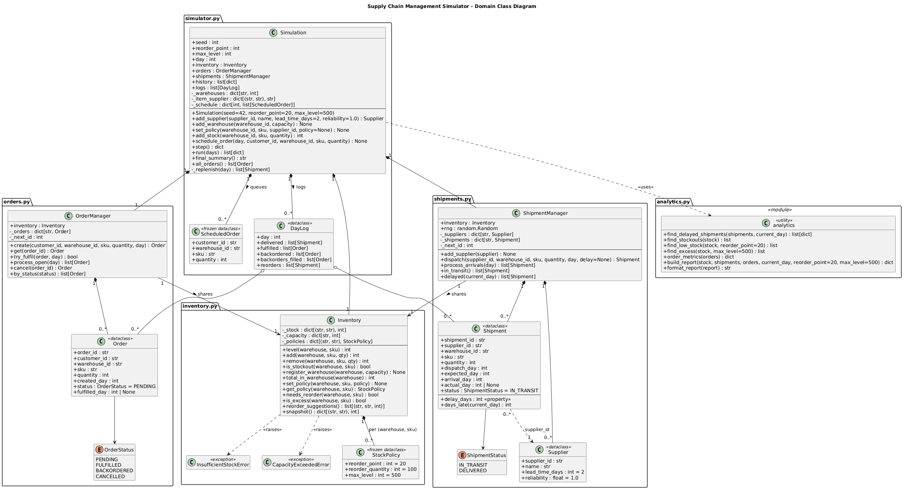

### 3.3 Component Diagram and Domain Class Diagram

This section gives two static views of the system: the **component view**, which shows the seven components and their dependencies, and the **domain class view**, which shows the classes inside the code components with their key fields, methods and relationships. Both diagrams are written in PlantUML; their sources are `docs/diagrams/component-diagram.puml` and `docs/diagrams/class-diagram.puml`.

#### 3.3.1 Component Diagram

*Figure 3.3-1: Component diagram*

**Components**

| Component | File | Layer | Owner | Requirements |
|---|---|---|---|---|
| CLI | `src/scm_sim/__main__.py` | Presentation | Rohith | SCM-F-043, SCM-NF-005 |
| Simulation Engine | `src/scm_sim/simulator.py` | Orchestration | Rohith | SCM-F-040, SCM-F-041, SCM-F-042 |
| Inventory | `src/scm_sim/inventory.py` | Domain | Rohith | SCM-F-001 – SCM-F-004 |
| Order Manager | `src/scm_sim/orders.py` | Domain | Rohanth | SCM-F-010 – SCM-F-013 |
| Shipment Manager | `src/scm_sim/shipments.py` | Domain | Rishi | SCM-F-020 – SCM-F-023 |
| Analytics | `src/scm_sim/analytics.py` | Analytics | Pranav | SCM-F-030 – SCM-F-033 |
| CI Pipeline | `.github/workflows/ci.yml` | Development infrastructure | Rohith | SCM-NF-003, SCM-SR-005 |

**Dependencies (solid arrows: "uses / calls")**

| From | To | Interface used | Purpose |
|---|---|---|---|
| Analyst / Instructor | CLI | `python -m scm_sim --days N --seed S` | Run the demo |
| CLI | Simulation Engine | `build_demo(seed)`, `Simulation.run(days)`, `Simulation.logs`, `Simulation.final_summary()`, `describe_day()` | Build the scenario, run it, print the log and report |
| Simulation Engine | Inventory | `register_warehouse`, `set_policy`, `add`, `reorder_suggestions`, `total_in_warehouse`, `snapshot` | Set-up, replenishment decisions, report input |
| Simulation Engine | Order Manager | `create`, `try_fulfil`, `process_open`, `by_status` | Serve today's demand, retry back-orders, collect orders for the report |
| Simulation Engine | Shipment Manager | `add_supplier`, `dispatch`, `process_arrivals`, `in_transit`, `delayed` | Register suppliers, replenish, deliver arrivals, collect late shipments |
| Simulation Engine | Analytics | `build_report`, `format_report` | Build each day's report and the final summary |
| Order Manager | Inventory | `level`, `remove` | Check and take stock when fulfilling |
| Shipment Manager | Inventory | `add` | Put arriving goods into stock |
| Developer | CI Pipeline | `git push` / pull request | Trigger the `test` job |
| CI Pipeline | `tests/` | `pytest -v --cov=scm_sim` | Run the whole suite and measure coverage |

Dashed arrows labelled `<<tests>>` show that the pytest suite in `tests/` exercises every code component: `test_inventory.py`, `test_orders.py`, `test_shipments.py` and `test_analytics.py` test their modules on their own, and `test_simulator.py` tests the Simulation Engine and the CLI end to end.

**Key properties of the component structure**

1. **Dependencies point one way.** The CLI depends on the Simulation Engine, which depends on the domain and analytics components; no component depends on the CLI or the Simulation Engine. This prevents cycles and lets each lower component be tested without the ones above it.
2. **Inventory is the only shared state.** The Order Manager and Shipment Manager receive the *same* `Inventory` object in their constructors. Neither imports the other; they interact only through stock levels, and the Simulation Engine decides when each one runs.
3. **Analytics has no dependencies.** `analytics.py` imports no other `scm_sim` module. It reads plain data (a stock snapshot dictionary and lists of shipment and order objects), so it can be tested with simple stand-in objects and cannot change simulation state.
4. **One place controls event order.** Only `Simulation.step()` calls the domain components during a run, so the order of events within a day is defined in exactly one place (see §4.1).
5. **CI guards `main`.** The CI Pipeline is not part of the runtime product, but it is part of the architecture: the `test` job is a required status check, so code reaches `main` only when the whole suite passes (SCM-NF-003, SCM-SR-005).

#### 3.3.2 Domain Class Diagram

*Figure 3.3-2: Domain class diagram (public members `+`, private members `-`)*

**Classes**

| Class | Module | Kind | Responsibility |
|---|---|---|---|
| `Simulation` | `simulator.py` | Class | Owns one `Inventory`, `OrderManager` and `ShipmentManager`; holds the scenario, the day counter, the report `history` and the `logs`; runs `step()` |
| `ScheduledOrder` | `simulator.py` | Frozen dataclass | One unit of customer demand queued for a future day (customer, warehouse, SKU, quantity) |
| `DayLog` | `simulator.py` | Dataclass | Record of one simulated day: shipments delivered, orders fulfilled, orders back-ordered, back-orders filled, reorders dispatched |
| `Inventory` | `inventory.py` | Class | Stock per (warehouse, SKU), capacity per warehouse, policy per item |
| `StockPolicy` | `inventory.py` | Frozen dataclass | Reorder point, reorder quantity and max level for one item (defaults 20 / 100 / 500) |
| `InsufficientStockError`, `CapacityExceededError` | `inventory.py` | Exceptions | Raised by `Inventory.remove` and `Inventory.add` when an operation would break a stock invariant |
| `OrderManager` | `orders.py` | Class | Creates, fulfils, retries, cancels and lists customer orders |
| `Order` | `orders.py` | Dataclass | One customer order with its status and fulfilment day |
| `OrderStatus` | `orders.py` | Enum (`str`) | `PENDING`, `FULFILLED`, `BACKORDERED`, `CANCELLED` |
| `ShipmentManager` | `shipments.py` | Class | Registers suppliers, dispatches shipments with seeded delays, delivers arrivals, lists in-transit and delayed shipments |
| `Supplier` | `shipments.py` | Dataclass | Supplier ID, name, lead time and reliability |
| `Shipment` | `shipments.py` | Dataclass | One replenishment shipment with its expected, arrival and actual days; computes `delay_days` and `days_late(day)` |
| `ShipmentStatus` | `shipments.py` | Enum (`str`) | `IN_TRANSIT`, `DELIVERED` |
| `analytics` | `analytics.py` | Module of functions | `find_delayed_shipments`, `find_stockouts`, `find_low_stock`, `find_excess`, `order_metrics`, `build_report`, `format_report` |

**Relationships**

| Relationship | Type | Multiplicity | Meaning |
|---|---|---|---|
| `Simulation` → `Inventory`, `OrderManager`, `ShipmentManager` | Composition | 1 to 1 each | Created in `Simulation.__init__` and live as long as the simulation |
| `Simulation` → `ScheduledOrder` | Composition | 1 to 0..* | Demand queued by day in `_schedule`; removed when its day is simulated |
| `Simulation` → `DayLog` | Composition | 1 to 0..* | One log appended per `step()` |
| `Simulation` ⇢ `analytics` | Dependency | – | Calls `build_report` and `format_report` |
| `OrderManager` → `Inventory`, `ShipmentManager` → `Inventory` | Association (shared) | 1 to 1 | Both hold a reference to the *same* `Inventory` instance |
| `OrderManager` → `Order` | Composition | 1 to 0..* | Orders stored in `_orders` by `order_id` |
| `ShipmentManager` → `Supplier`, `Shipment` | Composition | 1 to 0..* | Stored in `_suppliers` and `_shipments` by ID |
| `Shipment` ⇢ `Supplier` | Dependency by ID | 0..* to 1 | `Shipment.supplier_id` refers to a registered supplier |
| `Inventory` → `StockPolicy` | Composition | 1 to 0..* | One policy per (warehouse, SKU); defaults are used when none is set |
| `Order` → `OrderStatus`, `Shipment` → `ShipmentStatus` | Association | – | Current lifecycle state |
| `DayLog` → `Order`, `Shipment` | Aggregation | 0..* | References to objects owned by the managers |

**Design notes**

- **Records versus behaviour.** Plain records (`Order`, `Shipment`, `Supplier`, `StockPolicy`, `ScheduledOrder`, `DayLog`) are dataclasses; behaviour lives in the manager classes. `StockPolicy` and `ScheduledOrder` are frozen, so they cannot be changed after creation.
- **Validation in constructors.** `StockPolicy`, `Order`, `Supplier` and `Shipment` validate their fields in `__post_init__` and raise `ValueError` for invalid values (SCM-SR-001).
- **IDs instead of object links between modules.** Orders and shipments refer to warehouses, SKUs, customers and suppliers by string IDs (e.g. `WH-NORTH`, `WIDGET`, `C-ACME`, `SUP-RELIABLE`). This keeps the modules independent and the data easy to print and compare.
- **Enums that are also strings.** `OrderStatus` and `ShipmentStatus` subclass `str`, so Analytics can count statuses whether it receives enum members or plain strings.
