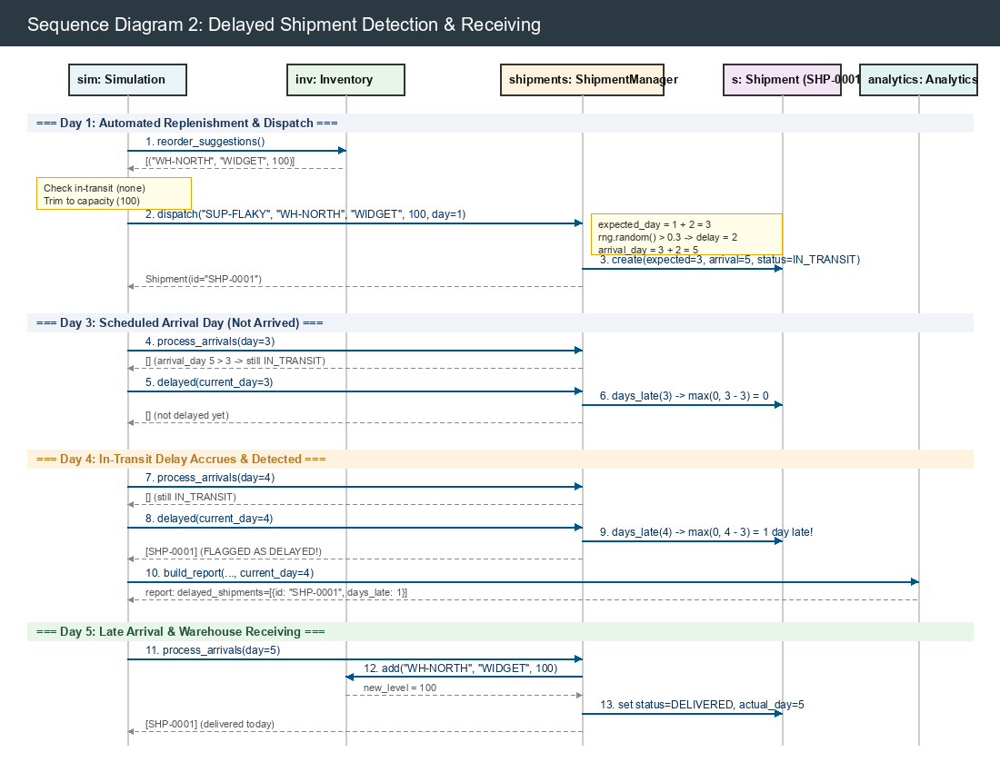

### 4.2 Sequence Diagram: Delayed Shipment Detection

The following sequence diagram models the lifecycle of a replenishment shipment experiencing stochastic transit delays, detailing the chronological interactions between the `Simulation` engine, `Inventory`, `ShipmentManager`, `Shipment`, and `Analytics` across simulated days 1 through 5.

#### Step-by-Step Sequence Walkthrough

1. **Day 1: Automated Replenishment Evaluation and Dispatch:**
   - In stage 4 of `Simulation.step()` at day 1, the simulation queries `Inventory.reorder_suggestions()`.
   - Inventory reports that SKU `WIDGET` at warehouse `WH-NORTH` is at or below its reorder point, suggesting a reorder quantity of 100 units.
   - The engine checks `ShipmentManager.in_transit()` to verify that no shipment for `(WH-NORTH, WIDGET)` is already pending, and trims the quantity to available warehouse capacity (100 units).
   - The engine calls `ShipmentManager.dispatch(supplier_id="SUP-FLAKY", warehouse_id="WH-NORTH", sku="WIDGET", quantity=100, day=1)`.
   - `ShipmentManager` looks up `SUP-FLAKY` (baseline `lead_time_days = 2`, `reliability = 0.3`).
   - `expected_day` is calculated as `1 + 2 = 3`.
   - Delay sampling: since `delay` is not explicitly provided, the pseudorandom draw from `random.Random` evaluates `rng.random() > 0.3` (True), triggering a delay of `rng.randint(1, 3)` (evaluating to 2 days).
   - `arrival_day` is computed as `expected_day + delay = 3 + 2 = 5`.
   - A `Shipment` instance is instantiated with ID `SHP-0001`, status `IN_TRANSIT`, `expected_day = 3`, and `arrival_day = 5`.

2. **Day 3: Scheduled Expected Arrival (Transit Incomplete):**
   - On day 3, `Simulation.step()` triggers `ShipmentManager.process_arrivals(day=3)`.
   - `ShipmentManager` checks all in-transit shipments: `SHP-0001` has `arrival_day = 5`, so `5 <= 3` is `False`. The shipment remains `IN_TRANSIT` and zero inventory is added.
   - The engine queries `ShipmentManager.delayed(current_day=3)`.
   - `SHP-0001.days_late(3)` evaluates `max(0, current_day - expected_day) = max(0, 3 - 3) = 0`.
   - The shipment is not yet classified as delayed, and `delayed()` returns an empty list `[]`.

3. **Day 4: In-Transit Delay Accrual and Exception Detection:**
   - On day 4, `process_arrivals(day=4)` verifies `arrival_day <= 4` (`5 <= 4` is `False`). The shipment remains `IN_TRANSIT`.
   - The engine queries `ShipmentManager.delayed(current_day=4)`.
   - `SHP-0001.days_late(4)` evaluates `max(0, 4 - 3) = 1`. Because `days_late > 0`, the shipment is flagged as an **in-transit delay**.
   - `delayed(4)` returns `[SHP-0001]`.
   - In stage 5, `analytics.build_report(...)` invokes `find_delayed_shipments(shipments, current_day=4)`, returning a record with `shipment_id="SHP-0001"`, `sku="WIDGET"`, `warehouse_id="WH-NORTH"`, and `days_late=1`.
   - The daily simulation report alerts the Supply Chain Analyst to the delayed goods.

4. **Day 5: Physical Inbound Receiving and Post-Delivery Historical Tracking:**
   - On day 5, `process_arrivals(day=5)` checks `SHP-0001`: `arrival_day <= 5` (`5 <= 5` is `True`).
   - `ShipmentManager` invokes `Inventory.add(warehouse="WH-NORTH", sku="WIDGET", qty=100)`, increasing warehouse stock to 100 units.
   - `SHP-0001` status transitions to `ShipmentStatus.DELIVERED`, and `actual_day` is recorded as `5`.
   - When subsequent delay checks run, `SHP-0001.delay_days` and `SHP-0001.days_late(5)` evaluate to `actual_day - expected_day = 5 - 3 = 2`.
   - The delivered shipment remains accurately tracked as **delivered late** in the simulation history for root-cause supplier performance analysis.
