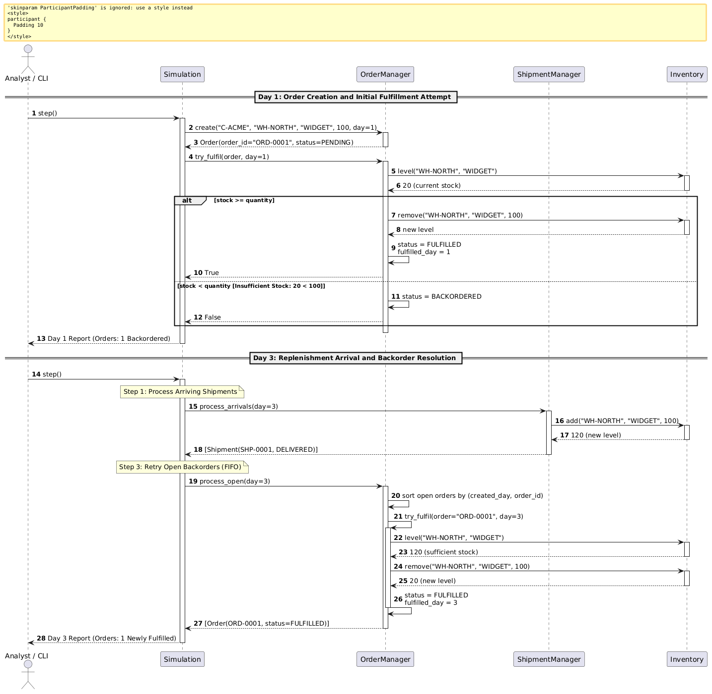

### 4.2 Sequence Diagram 1: Order Fulfilment and Back-Order Flow

This section details the dynamic execution flow for customer order creation, initial stock inspection, backorder transition, and subsequent resolution following replenishment delivery.

#### Step-by-Step Flow Explanation

The sequence diagram illustrates the lifecycle of customer order `ORD-0001` interacting with `Simulation`, `OrderManager`, `ShipmentManager`, and `Inventory` across two discrete simulation days:

1. **Step Trigger (Day 1):** The user or CLI invokes `Simulation.step()`, advancing the discrete time counter to Day 1.
2. **Order Instantiation:** The simulation orchestrator retrieves orders scheduled for Day 1 and calls `OrderManager.create(customer_id="C-ACME", warehouse_id="WH-NORTH", sku="WIDGET", quantity=100, day=1)`. The manager validates that quantity $> 0$, issues sequential identifier `"ORD-0001"`, stores the order internally with status `PENDING`, and returns the `Order` instance.
3. **Immediate Fulfillment Check:** The simulation invokes `OrderManager.try_fulfil(order, day=1)`. The manager queries `Inventory.level("WH-NORTH", "WIDGET")`, which returns current available stock of 20 units.
4. **Shortage & Backordering:** Because the available stock (20) is strictly less than the requested quantity (100), the all-or-nothing fulfillment rule triggers:
   - No inventory is deducted (stock remains at 20).
   - The order status transitions from `PENDING` to `BACKORDERED`.
   - `try_fulfil()` returns `False`.
5. **Day 1 Closure:** `Simulation` compiles Day 1 analytics, reflecting one active backorder, and outputs the day log.
6. **Step Trigger (Day 3):** Two days later, `Simulation.step()` is invoked for Day 3.
7. **Shipment Arrival (Step 1 of Daily Loop):** `Simulation` invokes `ShipmentManager.process_arrivals(day=3)`. Shipment `SHP-0001` (carrying 100 units of `WIDGET` dispatched from supplier `SUP-RELIABLE`) arrives. The shipment manager calls `Inventory.add("WH-NORTH", "WIDGET", 100)`, increasing total on-hand stock to 120 units, marks the shipment `DELIVERED`, and records `actual_day = 3`.
8. **FIFO Backorder Retry (Step 3 of Daily Loop):** Later in the Day 3 cycle, `Simulation` invokes `OrderManager.process_open(day=3)`. The manager collects all open orders (`PENDING` or `BACKORDERED`) and sorts them strictly oldest-first by `(created_day, order_id)`.
9. **Successful Fulfillment:** `ORD-0001` is evaluated first. `OrderManager` queries `Inventory.level("WH-NORTH", "WIDGET")`, which now returns 120 units. Because stock (120) $\ge$ quantity (100):
   - `Inventory.remove("WH-NORTH", "WIDGET", 100)` is called, reducing stock to 20 units.
   - The order status transitions to `FULFILLED` and `fulfilled_day = 3` is recorded.
   - `ORD-0001` is appended to the list of newly fulfilled orders returned to the simulation engine.
10. **Day 3 Closure:** The simulation records the fulfillment event in the Day 3 analytics report and updates the customer fill rate metric.
