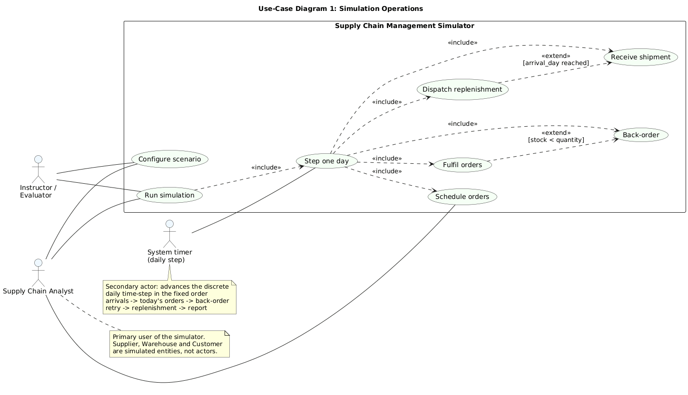
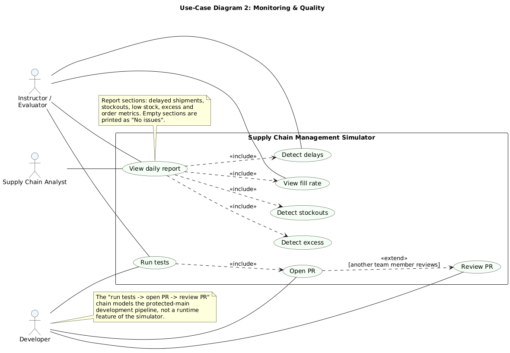

### 7. System Models

#### 7.1 UML Use-Case Diagrams

This subsection models the externally observable behaviour of the Supply Chain Management Simulator from the point of view of the human and automated participants defined in SRS §2.3. Two use-case diagrams are provided: **Diagram 1 (Simulation operations)** describes how a run is configured and advanced, and **Diagram 2 (Monitoring & quality)** describes how the results of a run are inspected and how the development pipeline is exercised. Both diagrams use only the actors and use cases defined below, and both are accompanied by an actor table and a use-case traceability table.

The following diagram presents the *Simulation operations* view of the system.

**Diagram 1 — Simulation operations.** The Supply Chain Analyst configures a scenario (suppliers, warehouses, per-item policies, initial stock), schedules customer orders for future days and starts a run. The **System timer** is modelled as a secondary actor that represents the discrete daily time-step: once a run is active it triggers *Step one day*, which internally includes *Receive shipment*, *Fulfil orders*, *Back-order* and *Dispatch replenishment* in the fixed order defined by SCM-F-041. *Back-order* extends *Fulfil orders* whenever the available stock is less than the requested quantity (SCM-F-011), and *Receive shipment* extends *Dispatch replenishment* once the shipment's arrival day is reached (SCM-F-023). The Instructor / Evaluator configures and runs scenarios to assess the system. Supplier, Warehouse and Customer are simulated entities held in the domain state; they are **not** actors.

The following diagram presents the *Monitoring & quality* view of the system.

**Diagram 2 — Monitoring & quality.** The Supply Chain Analyst *View daily report*, which includes the four detection and metric use cases *Detect delays* (SCM-F-030), *Detect stockouts*, *Detect excess* (both SCM-F-031) and *View fill rate* (SCM-F-032); the report text itself is produced by SCM-F-033. The Instructor / Evaluator reads the same reports and the aggregate metrics to assess whether the simulator behaves as specified. The Developer, a team member rather than an end user, *Run tests*, *Open PR* and *Review PR*; these three use cases model the protected-`main` development pipeline of SCM-SO-2 and SCM-SR-005 and are not runtime features of the simulator.

##### 7.1.1 Actors

| Actor | Type | Description | Use cases participated in |
| :--- | :--- | :--- | :--- |
| Supply Chain Analyst | Primary (human) | The end user of the simulator. Configures the supply network scenario, schedules customer demand, runs the simulation, and reads the daily analytics reports to find delays, stockouts, low stock, excess inventory and fill-rate shortfalls. | Configure scenario; Schedule orders; Run simulation; View daily report; Detect delays; Detect stockouts; Detect excess; View fill rate |
| System timer | Secondary (automated) | The discrete daily time-step of the simulation engine. Once a run is started it triggers one simulated day at a time, which drives shipment arrivals, order fulfilment, back-order retries and automatic replenishment in a fixed order. | Step one day; Fulfil orders; Back-order; Dispatch replenishment; Receive shipment |
| Instructor / Evaluator | Primary (human) | Runs the command-line demo and the test suite to assess the system against the problem statement and the requirements, and inspects the resulting reports and metrics. | Configure scenario; Run simulation; View daily report; Detect delays; View fill rate; Run tests |
| Developer | Supporting (human) | A member of the project team who extends a module, runs the automated test suite, and proposes reviewed changes to the repository through pull requests. | Run tests; Open PR; Review PR |
| Supplier *(not an actor)* | Simulated entity | External supplier entity modelled by the Shipment Manager. It receives no input from a human and produces no independent behaviour. | – |
| Warehouse *(not an actor)* | Simulated entity | Storage location modelled by the Inventory component. | – |
| Customer *(not an actor)* | Simulated entity | Origin of demand modelled by the Order Manager; customers only issue orders that the Analyst schedules. | – |

##### 7.1.2 Use Cases — Simulation Operations

| Use case | Description | Primary / secondary actor | Requirements exercised |
| :--- | :--- | :--- | :--- |
| Configure scenario | Register suppliers with lead time and reliability, register warehouses with a capacity, attach a per-item stock policy to a supplier, and load the initial stock of every tracked item. | Supply Chain Analyst; Instructor / Evaluator | SCM-F-020, SCM-F-040 |
| Schedule orders | Place customer orders against a warehouse and SKU for a future simulation day; past days, non-positive quantities and unknown warehouses are rejected. | Supply Chain Analyst | SCM-F-010, SCM-F-040 |
| Run simulation | Execute the configured scenario for a given number of days and print the day-by-day log together with the final report; exit code 0 on success. | Supply Chain Analyst; Instructor / Evaluator | SCM-F-041, SCM-F-043 |
| Step one day | Advance the simulation by exactly one simulated day, invoking shipment arrivals, today's orders, back-order retry, replenishment and report construction in that fixed order, and retain the resulting report. | System timer | SCM-F-041 |
| Fulfil orders | Attempt each open order against available stock; on success the stock is reduced, the status becomes `FULFILLED` and the fulfilment day is recorded. There is no partial fulfilment. | System timer | SCM-F-011, SCM-F-012 |
| Back-order | Mark an order `BACKORDERED` when stock is below the requested quantity, leaving stock unchanged, so that it is retried oldest-first on a later day. | System timer | SCM-F-011, SCM-F-012 |
| Dispatch replenishment | Dispatch exactly one replenishment per item that is at or below its reorder point and has nothing already in transit, trimmed so that on-hand plus in-transit quantity never exceeds the warehouse capacity. | System timer | SCM-F-042, SCM-F-003 |
| Receive shipment | On and after a shipment's arrival day, add its quantity to the destination warehouse stock, set the status to `DELIVERED` and record the actual day. | System timer | SCM-F-023 |

##### 7.1.3 Use Cases — Monitoring & Quality

| Use case | Description | Primary / secondary actor | Requirements exercised |
| :--- | :--- | :--- | :--- |
| View daily report | Read the report for the current day, which shows the day number, delayed shipments, stockouts, low stock, excess inventory and order counts with a fill rate. | Supply Chain Analyst; Instructor / Evaluator | SCM-F-033, SCM-F-041, SCM-NF-005 |
| Detect delays | List every shipment that is later than its expected arrival day, with its number of days late, ordered worst first. | Supply Chain Analyst; Instructor / Evaluator | SCM-F-030 |
| Detect stockouts | List every tracked item whose quantity is exactly zero, and every item whose quantity is at or below the reorder point but above zero, so that the shortfall is visible before it becomes a stockout. | Supply Chain Analyst | SCM-F-031, SCM-F-003 |
| Detect excess | List every tracked item above the maximum level together with the surplus quantity above that level, so that excess inventory and tied-up stock are visible. | Supply Chain Analyst | SCM-F-031 |
| View fill rate | Read the counts of orders per status and the fill rate, defined as fulfilled orders divided by total orders excluding cancelled orders, rounded to two decimal places. | Supply Chain Analyst; Instructor / Evaluator | SCM-F-032 |
| Run tests | Execute the automated pytest suite, with coverage measurement in CI, to confirm that every merged change is still correct. | Developer; Instructor / Evaluator | SCM-NF-003, SCM-NF-004 |
| Open PR | Propose a change on a feature branch for merge into the protected `main` branch, accompanied by the passing `test` check. | Developer | SCM-SO-2, SCM-SR-005 |
| Review PR | Inspect the files changed in a pull request against the requirements registry, leave at least one review comment, and approve so that the merge is permitted. | Developer | SCM-SO-2, SCM-SR-005 |